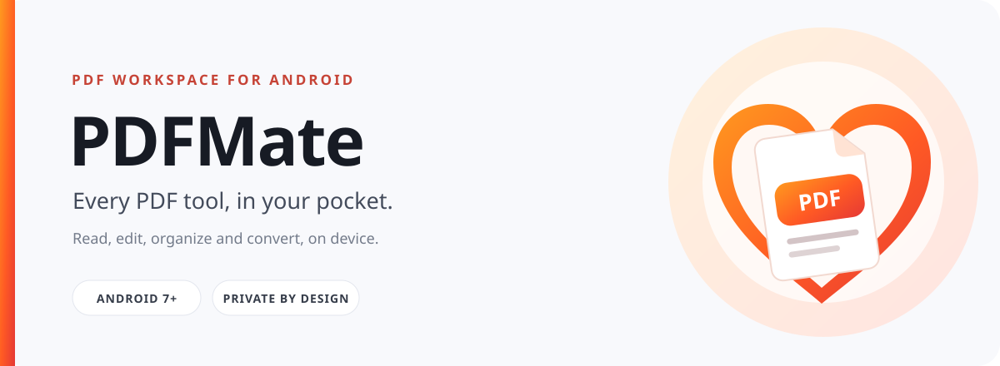
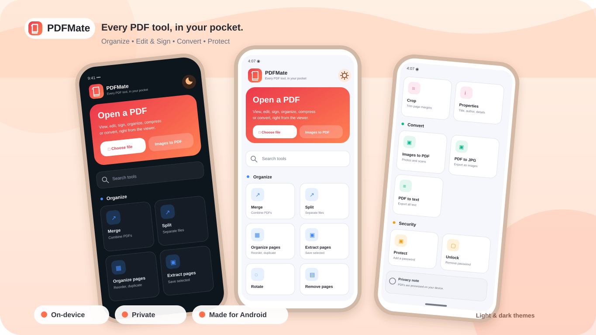
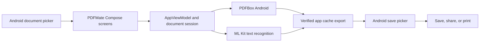

<div align="center">
  
  <br />
  <a href="#get-started">Build the app</a>
  &nbsp;·&nbsp;
  <a href="colab/remove_pdf_password.ipynb">Colab notebook</a>
</div>

<p align="center">
  
  
</p>

PDFMate is a native Android PDF workspace for reading, editing, organizing, and exporting documents. Everyday PDF work stays on your device, with no PDF upload service in this project.

<p align="center">
  
</p>

> [!IMPORTANT]
> The optional Colab notebook is a separate cloud workflow. A PDF uploaded there is processed in a Google-hosted runtime; review the [privacy notes](#privacy) before using it.

## Contents

- [Features](#features)
- [Google Colab](#google-colab)
- [Get started](#get-started)
- [How it works](#how-it-works)
- [Privacy](#privacy)
- [FAQ](#faq)
- [Contributing](#contributing)

## Features

<p align="left"></p>

<table>
  <tr>
    <td width="50%" valign="top">
      <p></p>
      <p><strong>Read without losing your place</strong></p>
      <p>Open PDFs, move between pages, zoom into details, and search document text.</p>
    </td>
    <td width="50%" valign="top">
      <p></p>
      <p><strong>Make focused changes</strong></p>
      <p>Edit text where supported, or add text, drawings, highlights, and signatures. Some fonts and content have limitations.</p>
    </td>
  </tr>
  <tr>
    <td width="50%" valign="top">
      <p></p>
      <p><strong>Put pages in order</strong></p>
      <p>Reorder, rotate, duplicate, crop, or delete pages. Merge, split, or extract documents and pages.</p>
    </td>
    <td width="50%" valign="top">
      <p></p>
      <p><strong>Protect and prepare</strong></p>
      <p>Add or remove password protection when authorized, edit metadata, fill forms, and add watermarks or page numbers.</p>
    </td>
  </tr>
  <tr>
    <td width="50%" valign="top">
      <p></p>
      <p><strong>Convert and enhance</strong></p>
      <p>Compress PDFs, run OCR on scans, and convert between PDFs, images, and text.</p>
    </td>
    <td width="50%" valign="top">
      <p></p>
      <p><strong>Finish and share</strong></p>
      <p>Save a copy, share it with another app, or print through Android. Shared files go to the app you choose.</p>
    </td>
  </tr>
  <tr>
    <td colspan="2" valign="top">
      <p></p>
      <p><strong>Optional Google Colab password removal</strong></p>
      <p>Remove protection only when you already know the PDF password. This separate, opt-in notebook runs in Google's hosted environment. <a href="#google-colab">See the Colab workflow</a>.</p>
    </td>
  </tr>
</table>

PDFMate preserves document structure when the PDF engine supports the operation; ordinary edits do not silently rasterize pages.

## Google Colab

The optional notebook removes password protection when you already know the document password. It uses pikepdf/qpdf to rewrite PDF objects; it does not guess passwords or rasterize pages.

1. Open the [notebook in Colab](https://colab.research.google.com/github/Sampath315/PDFMate/blob/main/colab/remove_pdf_password.ipynb) and connect to a Python 3 runtime. The default CPU runtime is enough; Drive and a GPU are not required.
2. Run **Install pikepdf**, then **Upload one PDF** and choose one local PDF.
3. Enter the password in the hidden prompt. Do not put it in a code cell.
4. Run **Decrypt, verify, and download**. The notebook verifies that the output opens without a password and has the same page count before downloading it.
5. Run **Optional cleanup** to remove the source and output from the runtime, or disconnect and delete the runtime when finished.

> [!WARNING]
> Colab uploads the selected PDF to Google's hosted runtime. This is separate from the on-device Android app. Do not use the notebook for confidential documents unless Google's processing and retention policies are acceptable. The notebook does not mount Drive, and the downloaded output is not automatically saved there.

## Get started

### Requirements

| Tool        | Version                                                           |
| ----------- | ----------------------------------------------------------------- |
| Android     | 7.0 (API 24) or later                                             |
| JDK         | 17                                                                |
| Android SDK | Platform 37 and the components requested by Android Gradle Plugin |

Clone this repository from its GitHub page, then build a debug APK from the project directory:

```bash
cd PDFMate
./gradlew :app:assembleDebug
```

Debug APKs are written to `app/build/outputs/apk/debug/`. Release builds currently target `arm64-v8a` and are written to `app/build/outputs/apk/release/`.

To create an installable signed release in Android Studio, choose **Build → Generate Signed Bundle / APK → APK** and follow the signing wizard. The tag-based GitHub release workflow currently publishes **unsigned** APKs.

Run the local checks with:

```bash
./gradlew :app:testDebugUnitTest :app:compileDebugAndroidTestKotlin :app:lintDebug
```

Instrumented tests require a connected Android device or emulator:

```bash
./gradlew :app:connectedDebugAndroidTest
```

## How it works

The Android app is a single application module. Compose screens coordinate document sessions through `AppViewModel`; PDF operations and rendering use PDFBox Android, and OCR uses ML Kit.



## Privacy

- The Android app processes selected documents on-device and has no project-owned PDF upload backend.
- Android's document picker, sharing, and printing can pass a file to the external app you select.
- The Colab notebook is an opt-in Google-hosted workflow; uploaded files are subject to Google's service and retention policies.
- PDFMate does not attempt password guessing or brute force. Only modify documents you own or are authorized to change.
- See [PRIVACY.md](PRIVACY.md) and [SECURITY.md](SECURITY.md) for details and reporting guidance.

## FAQ

<details>
<summary>Does the Android app upload my PDFs?</summary>

No. PDF processing in the app is on-device. If you choose a share, print, or other external-app action, Android passes the file to the app you selected.

</details>

<details>
<summary>Can PDFMate crack a password?</summary>

No. Password protection can only be removed when you already know the password. The optional Colab notebook follows the same rule.

</details>

<details>
<summary>Why are there multiple APK files?</summary>

Each release APK targets one processor architecture. Install the matching ABI; `arm64-v8a` is the usual choice for a modern phone. There is no universal APK in the current build configuration.

</details>

<details>
<summary>Are GitHub release APKs signed?</summary>

No. The current tag-based release workflow publishes unsigned APKs. Create a signed build through Android Studio before distributing an installable release.

</details>

## Contributing

Bug reports and pull requests are welcome. Read [CONTRIBUTING.md](CONTRIBUTING.md) before submitting changes. Do not attach private PDFs, passwords, or other sensitive document data to public issues.
